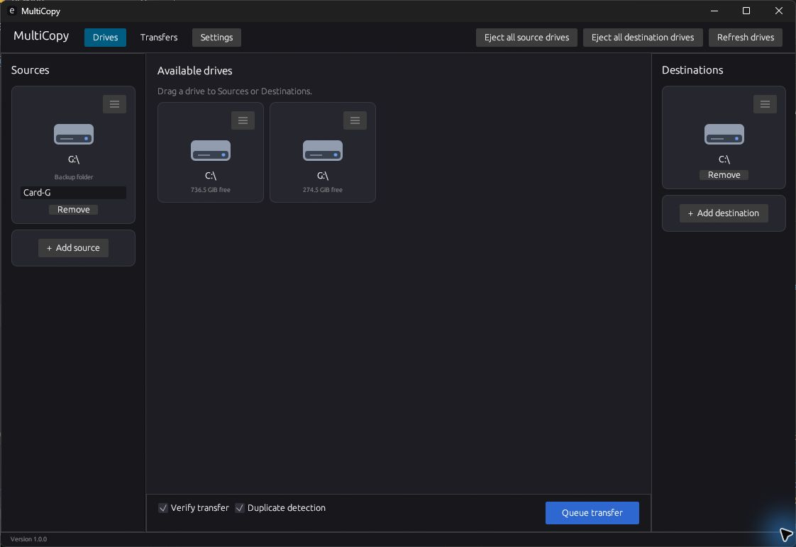

# MultiCopy

MultiCopy is a Rust desktop app for copying camera cards, media folders, and other large files to one or more backup drives. It runs transfers from different source disks in parallel and reads each source file once when writing to multiple destinations.

## Download

Get the Windows x64 executable or the macOS Universal ZIP from [GitHub Releases](https://github.com/mkunz7/multicopy/releases). The Mac archive contains an app for Apple Silicon and Intel. This build is ad hoc signed and unnotarized.

## Use MultiCopy

1. Drag a drive from the center into **Sources** or **Destinations**. Use the three-line menu to choose a folder on that drive, or browse from either side panel.
2. Set a backup folder name for each source, then click **Queue transfer**. MultiCopy creates each named folder inside every selected destination and preserves the source folder structure.
3. Follow progress in **Transfers**. After the queue is idle, use the eject buttons to request safe removal of selected drives.

Jobs on the same source disk run in order. Different source disks can copy concurrently, even when they share a destination drive.

**Duplicate detection** is on by default. To resume, click **Retry** on a failed or canceled job, or queue it again with the same destinations and backup folder name. MultiCopy compares existing files byte for byte, skips matches, and copies missing files. If a file at the same relative path differs, MultiCopy preserves the existing copy and reports the conflict.

**Verify transfer** compares each new destination copy with the source using XXH64BE. MultiCopy writes a dated report in the **Transfer Logs** folder alongside each destination's backup folder. The report includes per-file checksums and details of matching files that were skipped.

## Build from source

Install Rust and the platform's native toolchain. On Windows, use the Visual Studio C++ build tools with the MSVC Rust target, or use a GNU Rust toolchain with MinGW-w64. On macOS, install the Xcode Command Line Tools.

~~~sh
cargo build --locked --release
cargo test --locked --release
~~~

The executable is at **target/release/multicopy.exe** on Windows and **target/release/multicopy** on macOS.

On a Mac, build and package both architectures with Python 3.11 or later.

~~~sh
rustup target add aarch64-apple-darwin x86_64-apple-darwin
MACOSX_DEPLOYMENT_TARGET=11.0 cargo build --locked --release --target aarch64-apple-darwin --target x86_64-apple-darwin
python3 scripts/package_macos.py
~~~

The Universal ZIP is written to **dist/**.

## License

MultiCopy is distributed under the [GNU General Public License v3.0](LICENSE).
